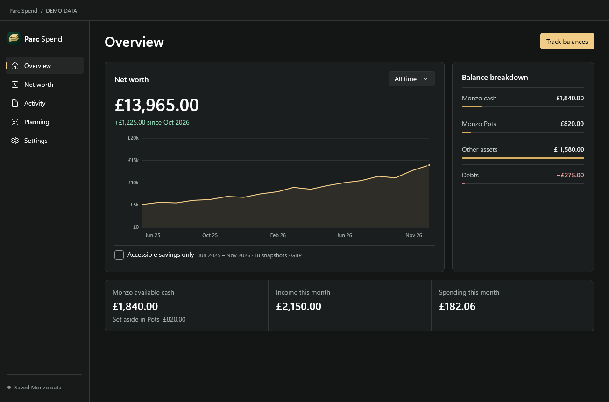
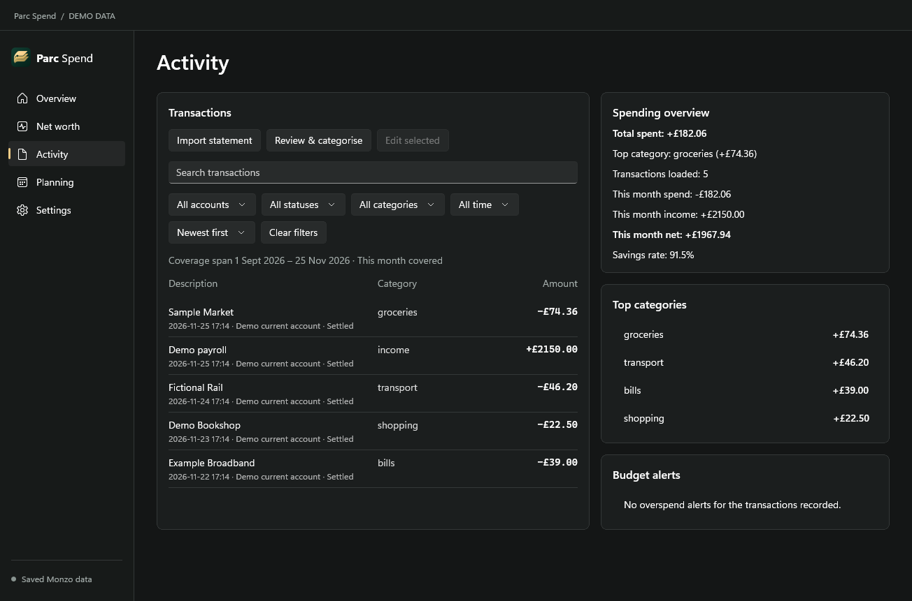
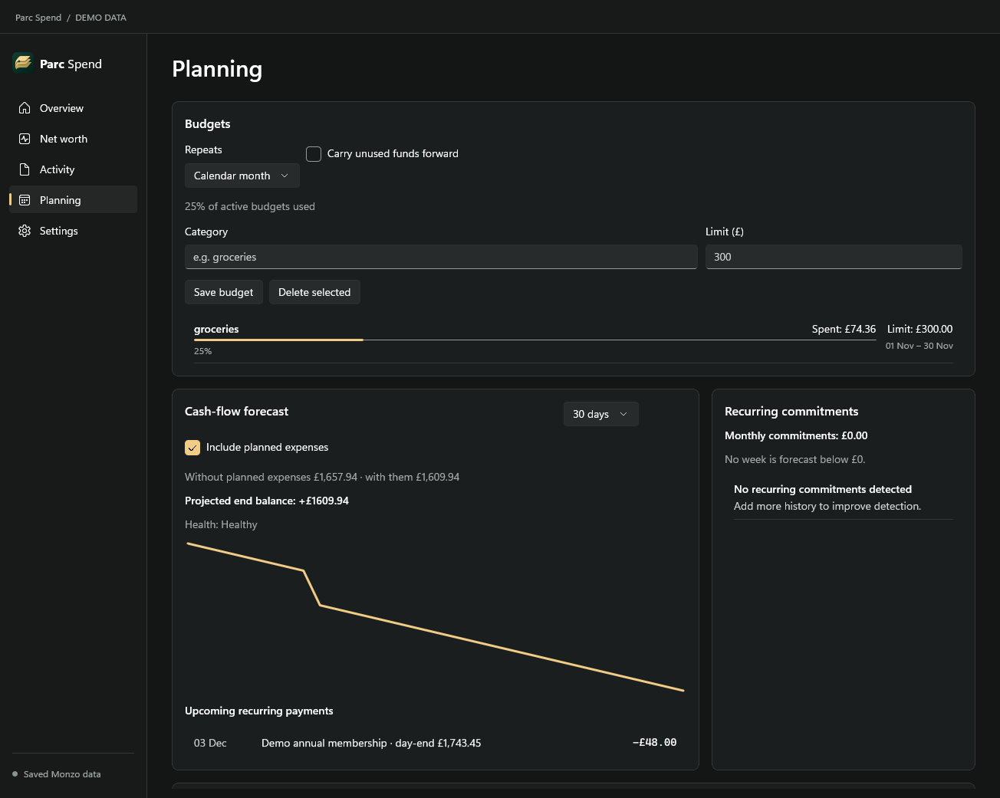

# Parc Spend

Parc Spend is a Windows app for keeping track of what you own, what you owe, and where your money goes. Track balances manually, bring in spreadsheet and statement history, or connect Monzo for account and transaction sync.

## Overview

See your net worth month by month, switch to accessible savings, and compare cash, Pots, other assets, and debts. In **Net worth**, review your balances in one place, record a monthly snapshot, or import months from a spreadsheet.



## Activity

Find and filter transactions across Monzo and imported accounts. See which periods your records cover, distinguish pending payments from settled transactions, and link transfers so moving money between accounts does not inflate your spending. Split purchases across categories and track refunds and reimbursements.



## Planning

Set one-off, calendar-month, or payday budgets. Compare a cash-flow forecast with and without planned purchases, and use a tracked balance or Monzo Pot to measure progress toward a savings goal.



**All screenshots use fictional demo data.** The balances, accounts, merchants, transactions, and plans were created for the documentation.

## Download

Check [GitHub Releases](https://github.com/samparchao/Parc-Spend/releases) for installer builds. You can also build the self-contained Windows x64 installer locally with Inno Setup 6.6 or newer.

```powershell
.\scripts\build-installer.ps1
```

The installer is written to `artifacts\installer\ParcSpend-Setup.exe`.

## Build and run

1. On Windows, install Visual Studio with the .NET desktop and Windows SDK build tools, plus the .NET 10 SDK.
2. Open Visual Studio Developer PowerShell in this repository and run the command below.
3. Launch `MonzoManager.exe` from the build output. Start with **Net worth → Add balance** or **Activity → Import statement**.

```powershell
msbuild .\MonzoManager.csproj -restore -p:Configuration=Debug -p:Platform=x64 -p:RestoreLockedMode=true
```

Parc Spend uses C# and WinUI 3. Manual balances, CSV imports, and planning work offline. For Monzo setup, CSV formats, backups, and monthly reviews, see the [usage guide](docs/usage.md).

## Privacy and local data

Parc Spend stores the workspace under `%APPDATA%\MonzoManager`. New saves and saved Monzo credentials use Windows DPAPI for the current Windows user. The app reads older JSON files and encrypts them when they are saved again. Monzo sign-in and sync communicate with Monzo. Backups use password-based encryption and exclude Monzo credentials and tokens. CSV exports are readable files containing the values you export.

Parc Spend is an independent project and is unaffiliated with Monzo.
